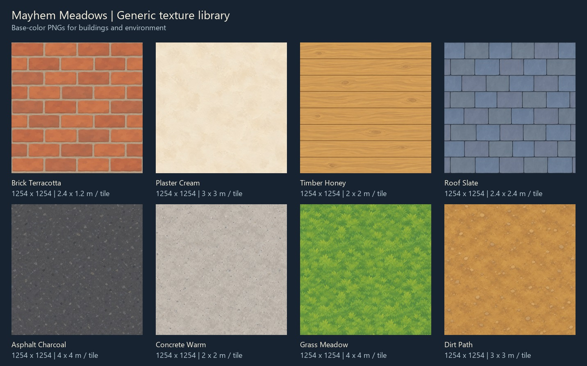

# Generic texture library

Eight reusable building and environment base-color textures for Mayhem Meadows. These are standalone assets for the map rework; no current map or renderer materials use them yet.

## Materials

| File | Intended surface | Starting coverage per tile |
| --- | --- | --- |
| [buildings/brick-terracotta.png](buildings/brick-terracotta.png) | Neighborhood masonry and shop walls | 2.4 x 1.2 m |
| [buildings/plaster-cream.png](buildings/plaster-cream.png) | Painted walls; suitable for subtle color tinting | 3 x 3 m |
| [buildings/timber-honey.png](buildings/timber-honey.png) | Horizontal siding, fences, and timber outbuildings | 2 x 2 m |
| [buildings/roof-slate-v2.png](buildings/roof-slate-v2.png) | Slate-style roof shingles | 2.4 x 2.4 m |
| [environment/asphalt-charcoal.png](environment/asphalt-charcoal.png) | Roads and parking surfaces; add markings separately | 4 x 4 m |
| [environment/concrete-warm.png](environment/concrete-warm.png) | Sidewalks and concrete; add slab joints separately | 2 x 2 m |
| [environment/grass-meadow.png](environment/grass-meadow.png) | Lawns, verges, and open meadow ground | 4 x 4 m |
| [environment/dirt-path.png](environment/dirt-path.png) | Paths, bare earth, and yard ground | 3 x 3 m |

Coverage is an art-direction starting point, not a required world scale. Keep brick, plank, and roof courses horizontal when creating UVs.

## Asset format and review

The source PNGs are opaque, square, 1254 x 1254 pixels, with a softly painted style and subdued surface contrast. They contain color only, with no accompanying normal, roughness, or displacement maps. Use sRGB when importing. The built-in image generator returned this native size despite the initial prompts requesting 1024 x 1024; these files preserve its output. A later asset pipeline can create 1024 x 1024 runtime copies if needed.

All eight PNGs were decoded, checked for square dimensions and opacity, and visually reviewed individually and in [2 x 2 repeat previews](previews/repeat-grid.jpg). The textures are intended for horizontal and vertical repetition; review their perceived scale on the final meshes. The preview JPEGs contain labels and are reference sheets, not material textures.

[manifest.json](manifest.json) records each path, actual resolution, SHA-256 hash, suggested tile coverage, and generation prompt. To recreate an initial prompt, concatenate `generation.commonPrompt`, a newline, `Subject/material: `, and the material's `subjectPrompt`. The roof texture also records its follow-up seam refinement in `edits`. All textures were generated on October 6, 2026 using the built-in `image_gen` tool, one image per material. No external asset pack or reference image was used; the roof refinement referenced its own initial generated tile.

## Applying after the map rework

Load each PNG as a color texture with `THREE.SRGBColorSpace`, `THREE.RepeatWrapping` on both axes, and mipmapped filtering. A white material color preserves the authored palette; other colors multiply it. Share texture instances between matching materials, keep texture/UV repeat settings consistent, and register them for disposal with the renderer's existing texture lifecycle.

The current geometry pipeline needs UV work before application: `Scene3D._bakeStatics()` copies position and normal attributes but discards UVs, and the road ribbons and gable roofs have no UV attributes. Preserve UVs when batching and create them for those surfaces. Keep texture scale tied to world distance rather than stretching one tile over each object.

The optional server in `tools/serve.cjs` currently serves an explicit game-file allowlist without PNG/JPEG MIME types. Extend its allowed paths and image MIME types when wiring in this library. Recheck the project's direct `file://` play mode as well as localhost once asynchronous image loading is introduced.
